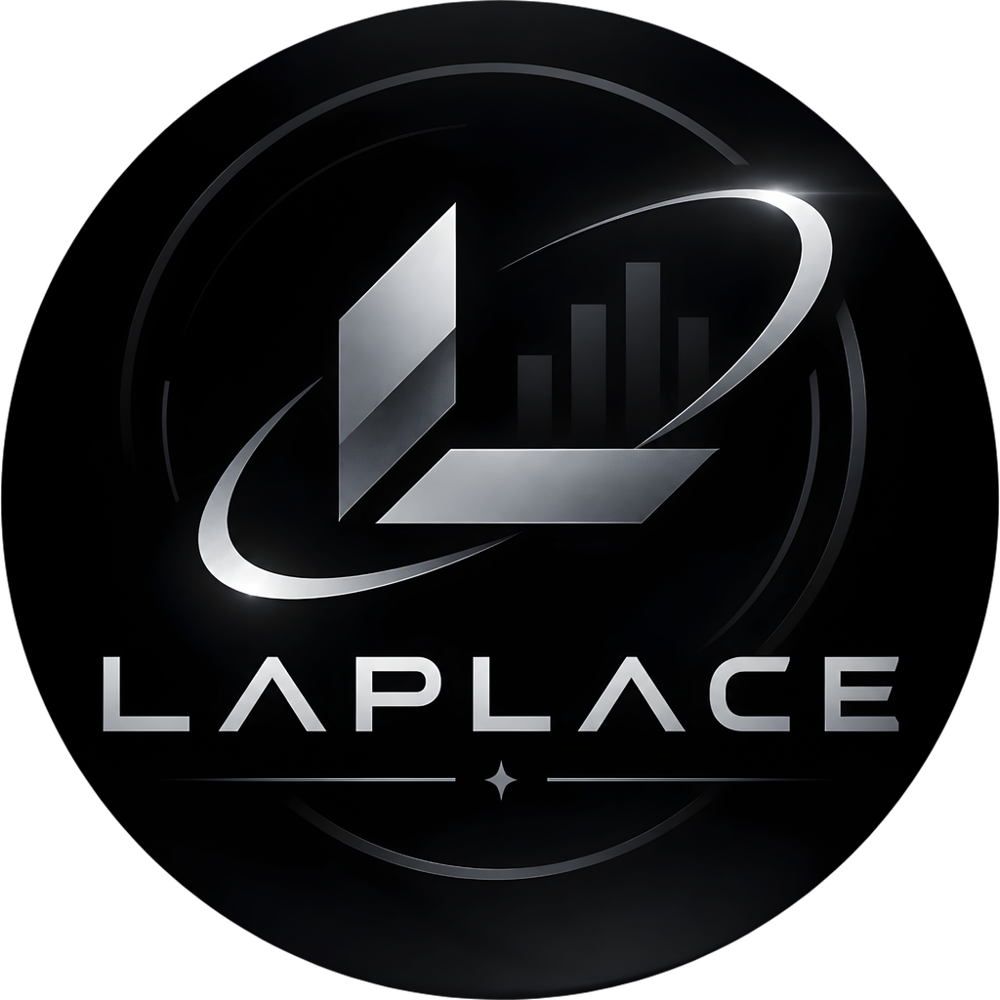

  

<h1 align="center">Laplace</h1>

  
  
  
  
  
  

<strong>⚽ Pronósticos de fútbol que te dicen de dónde sale cada número — con bot de Telegram, agente de chat, web, PWA y app Android.</strong>

Laplace junta en un solo proyecto un motor estadístico (modelo histórico Dixon-Coles + cuotas del mercado sin margen), un bot de Telegram, un agente de chat, una web, una PWA y una app Android. La idea es sencilla: que un pronóstico venga con su evidencia, y que si faltan datos el sistema lo diga en vez de inventarse una cifra bonita.

## 🚫🎰 Aquí se pronostica, no se apuesta

Laplace **no es una casa de apuestas** y nunca lo va a ser: no recibe dinero, no intermedia apuestas, no guarda fondos y no te pide nada a cambio de un resultado. Las cuotas del mercado son solo un **insumo estadístico** del análisis, no una oferta. Esto es una herramienta para **ver pronósticos y entender el análisis**, nada más. Tampoco garantiza aciertos: el fútbol sorprende, y un pronóstico es una probabilidad, no una promesa.

## Estado del proyecto 🚧

Está en desarrollo activo y se construye con calma, a ratos libres: puede tener cosas por pulir y partes que funcionan mejor que otras. Si algo falla, [abre un issue](../../issues): un reporte real ayuda mucho más que cualquier opinión.

## Cómo se hizo 🤝🤖

El código de Laplace lo escribió **[Claude Code](https://claude.com/claude-code)** (de Anthropic) trabajando en pareja con el creador del proyecto, que hizo de **arquitecto**: decide qué se construye y cómo, y revisa y prueba lo que se entrega. Es un proyecto de código abierto asistido por IA, y lo decimos tal cual.

## Qué puede hacer 🔥

🎯 **Pronósticos con evidencia.** Cada resultado trae su *nivel de evidencia* (de N4, histórico + cuotas, hasta N0, sin pronóstico propio) y los módulos que lo sostienen. Si un partido no tiene con qué pronosticarse, te explica por qué en lugar de rellenar ([cómo funciona](docs/motor-de-pronostico.md)).

📊 **Se mide contra referencias reales.** La tasa base de la liga y las cuotas sin margen son el listón; las métricas son RPS y log-loss, y la evaluación no mira el futuro (walk-forward). Si un modelo no mejora al mercado, no entra.

🤖 **Bot de Telegram.** `/juegos` para elegir día, liga y partido, `/hoy` con lo que sí tiene pronóstico, `/top` con los Top Picks del día y `/stats` con el rendimiento real del bot ([comandos](docs/telegram-y-agente.md)).

🧠 **IA que explica, no que inventa probabilidades.** Ollama Cloud primero, con respaldo en Groq, Gemini, OpenRouter y Claude. La IA redacta y contrasta; las probabilidades salen del motor.

💬 **Un agente de chat.** Consulta las herramientas deportivas del backend, recuerda tu contexto y deja trazadas sus acciones. Funciona por la web, la PWA y su propio bot de Telegram.

🌐📱 **Web, PWA y app Android.** La web se sirve sola desde el backend; la PWA está pensada para el móvil; la app Android está hecha con Kotlin y Compose ([detalles](docs/web-pwa-y-android.md)).

🧰 **Instalación que se encarga de todo.** Un `instalar.bat` (o `instalar.sh`) descarga su propio Python —y Node, si hace falta—, verifica cada descarga con SHA-256 y lo deja todo dentro de la carpeta, sin tocar tu sistema y sin permisos de administrador.

🔑 **Configurar tus APIs sin sufrir.** `configurar` detecta qué claves tienes, prueba cada API con una llamada gratuita (✓ / ✗ / ⚠), te da el enlace para conseguir cada clave y la guarda por ti, sin mostrarla. Lo puedes abrir cuando quieras para cambiar claves o proveedores; el panel web trae la misma pantalla.

🔐 **Tus secretos son tuyos.** Las claves viven en un `.env` que nunca se sube a git ni se muestra en pantalla; el instalador las pide sin eco.

## Empezar rápido ⚡

| | Windows | Linux / macOS / WSL |
|---|---|---|
| 1. Instalar | `instalar.bat` | `bash instalar.sh` |
| 2. Configurar tus APIs | `configurar.bat` | `./configurar.sh` |
| 3. Iniciar | `iniciar.bat` | `./iniciar.sh` |
| 4. Abrir | <http://127.0.0.1:9001/> | <http://127.0.0.1:9001/> |

`iniciar` te avisa si falta algo clave y abre la web. Para apagar, ver el estado o revisar la instalación está `laplace.bat` (`detener`, `estado`, `doctor`). La receta completa —clonar, configurar tus claves, primer uso, actualizar— está en **[guia.md](guia.md)**, y lo que necesitas antes de empezar, en **[requisitos.md](requisitos.md)**.

## Qué no trae este repositorio 🧩

Para que no te sorprenda: **no incluye datos históricos ni modelos entrenados**. Salen de fuentes con licencias propias y cada quien debe usar las suyas. Sin modelo propio, el motor trabaja con las **cuotas** (necesitas una clave de The Odds API, hay plan gratis); sin cuotas tampoco, el partido queda como «sin pronóstico propio» y el bot te lo dice con sus motivos. Si quieres entrenar tu propio modelo, está explicado en [docs/motor-de-pronostico.md](docs/motor-de-pronostico.md).

## Qué hay en la carpeta 🗂️

| Carpeta | Qué encuentras |
|---|---|
| [`instalar`](instalar.bat) · [`configurar`](configurar.bat) · [`iniciar`](iniciar.bat) (`.bat` / `.sh`) · [`laplace`](laplace.bat) | Instalar, poner tus claves, encender y controlar Laplace |
| [`install/`](install/) | Instalador, asistente de claves, versiones y huellas de los runtimes |
| [`backend/`](backend/) | API (FastAPI), bot de Telegram, motor de pronóstico, base de datos, agente, guías y pruebas |
| [`frontend/`](frontend/) | La web (React + Vite) |
| [`pwa/`](pwa/) | La PWA (React + Vite) |
| [`app-android/`](app-android/) | La app Android (Kotlin + Compose) |
| [`docs/`](docs/INDEX.md) | Documentación (arquitectura, backend, app, web, QA, despliegue) |
| [`.claude/`](.claude/) | Reglas, agentes y skills con las que se trabajó con Claude Code (una selección) |

## Pruebas 🧪

Más de mil pruebas automáticas: `pytest` para `backend/tests` y `backend/agents/tests`, y `pnpm test` en `frontend/` y `pwa/`. Para Node se usa **pnpm**, no npm.

## Documentación 📚

[Guía paso a paso](guia.md) · [Requisitos](requisitos.md) · [Configuración del `.env`](docs/configuracion.md) · [Arquitectura](docs/arquitectura/VISION_GENERAL.md) · [Motor de pronóstico](docs/motor-de-pronostico.md) · [Telegram y agente](docs/telegram-y-agente.md) · [Web, PWA y Android](docs/web-pwa-y-android.md) · [Seguridad y datos](docs/seguridad-y-datos.md)

## Contribuir 🙌

¿Quieres aportar? Lee [CONTRIBUTING.md](CONTRIBUTING.md): ahí está el flujo, qué correr antes de enviar y las reglas del proyecto.

## Créditos 🙏

Laplace se apoya en un montón de software libre: [FastAPI](https://fastapi.tiangolo.com/), [SQLAlchemy](https://www.sqlalchemy.org/), [Alembic](https://alembic.sqlalchemy.org/), [python-telegram-bot](https://python-telegram-bot.org/), [APScheduler](https://apscheduler.readthedocs.io/), [React](https://react.dev/), [Vite](https://vitejs.dev/), [Tailwind CSS](https://tailwindcss.com/), [Kotlin](https://kotlinlang.org/) con [Jetpack Compose](https://developer.android.com/compose), [uv](https://docs.astral.sh/uv/) y [pnpm](https://pnpm.io/). Gracias a todas esas comunidades.

## Licencia 📄

[GNU AGPL-3.0](./LICENSE).
